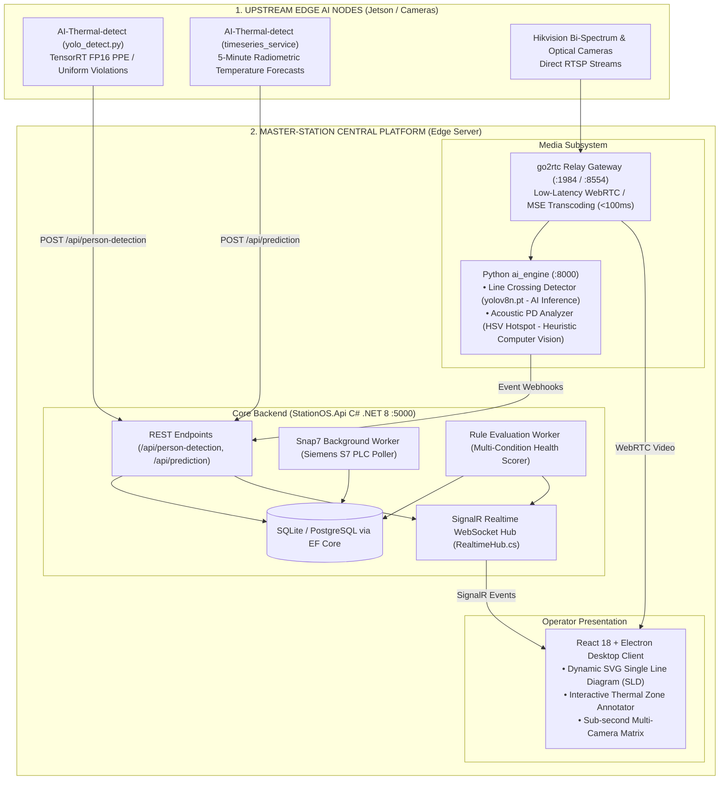
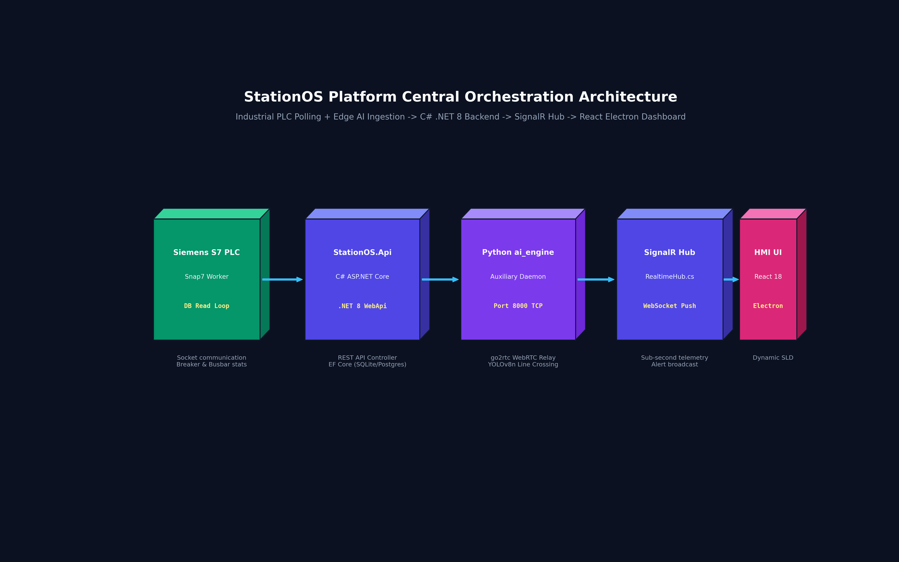
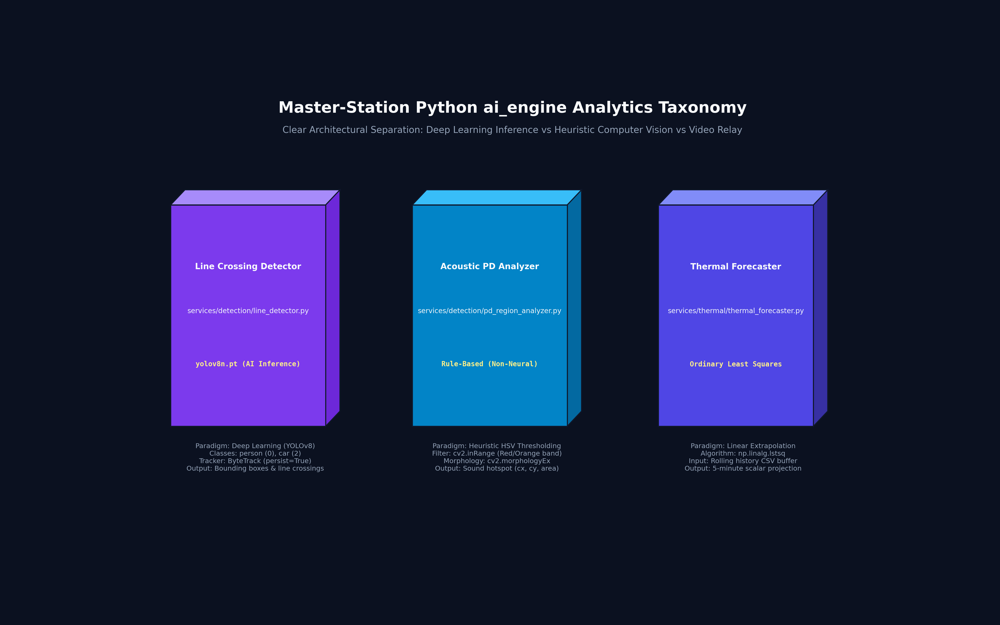
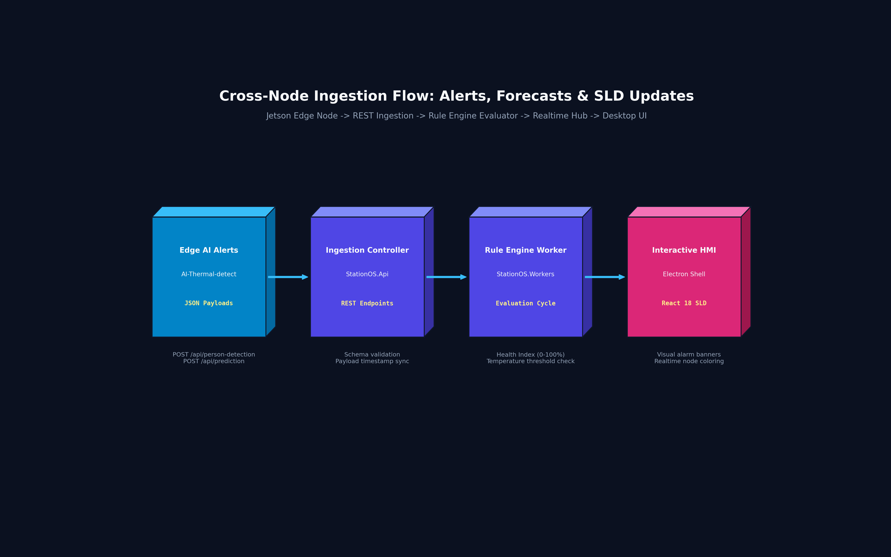

# StationOS: Industrial Substation Monitoring & Edge-to-Station Orchestration Platform
### An Offline-Resilient SCADA Platform Integrating C# .NET 8 Backend Services, SignalR Real-Time Telemetry, Snap7 PLC Communication, and React/Electron Desktop HMI

[](https://dotnet.microsoft.com/)
[](https://react.dev/)
[](https://www.electronjs.org/)
[-00646E.svg)](https://snap7.sourceforge.net/)
[](docs-project/commercialization_and_licensing.md)

---

## 1. Architectural Scope & Positioning

> **Important Notice on Role & System Boundaries:**  
> **Master-Station** is the **Central Station Orchestration, SCADA Integration, and Operator Interface Layer (StationOS)**.  
> It does not train core computer vision or deep time-series neural networks. Instead, it aggregates telemetry across industrial edge devices, ingests AI-generated safety events and temperature forecasts, evaluates multi-variable health rules, and interfaces directly with electrical switchgear via Siemens S7 PLCs.

Upstream Edge AI nodes providing computer vision and thermal forecasting:
👉 **[`AI-Thermal-detect`](https://github.com/neitpm/AI-Thermal-detect)** *(Edge AI Inference & Time-Series Engine)*  
👉 **[`Get-Thermal-Jetson-nano`](https://github.com/neitpm/Get-Thermal-Jetson-nano)** *(Radiometric Acquisition Daemon)*

---

## 2. Integrated Edge-to-Station Architecture

StationOS functions as an offline-resilient edge server running inside the substation control room:



---

## 3. High-Resolution 3D Volumetric Architecture Figures

Below is the suite of isometric 3D volumetric tensor block diagrams illustrating StationOS platform subsystems:

#### Figure 1: StationOS Platform Central Orchestration Architecture
*Industrial PLC polling, edge AI event ingestion, C# ASP.NET Core .NET 8 backend routing, SignalR broadcasting, and React/Electron desktop HMI.*


#### Figure 2: Master-Station Python ai_engine Analytics Taxonomy
*Explicit architectural separation between deep learning object tracking (`line_detector.py`), heuristic HSV hotspot extraction (`pd_region_analyzer.py`), and linear extrapolation.*


#### Figure 3: Cross-Node Ingestion Flow: Alerts, Forecasts & SLD Updates
*Telemetry progression from Jetson Edge nodes into backend REST controllers, rule evaluation workers, and real-time interactive SVG single-line diagrams.*


---

## 4. Subsystem Technical Overview

### A. Backend Core (C# ASP.NET Core .NET 8)
- **High-Performance Ingestion:** Exposes strongly typed endpoints receiving structured JSON payloads from edge detectors (`/api/person-detection`) and forecasters (`/api/prediction`).
- **Industrial PLC Integration (`StationOS.Workers`):** Continuous background polling of Siemens S7-300/1200/1500 PLCs using native socket connections via **Snap7** to read circuit breaker states, busbar voltages, and active power.
- **Dynamic Equipment Health Scorer:** Evaluates multi-parameter heuristics combining electrical current, thermal spot temperatures, and partial discharge acoustic intensity to compute a real-time asset health index (0–100%).
- **Offline Hardware Licensing:** Enforces cryptographic node-locked license keys generated from motherboard and CPU Hardware IDs (`LicenseController.cs`).

### B. Python AI Engine Auxiliary Service (`ai_engine/`)
- Runs as an independent microservice on port `8000`:
  1. **Line Crossing Monitor (`line_detector.py`):** Uses an official pretrained `yolov8n.pt` with ByteTrack to trigger boundary-crossing alarms when personnel cross virtual lines. *(Neural AI Inference)*
  2. **Partial Discharge Acoustic Analyzer (`pd_region_analyzer.py`):** Analyzes video feeds from acoustic imaging cameras; identifies discharge acoustic energy hotspots via HSV color-space thresholding (red/orange spectrum) and correlates coordinates with equipment boundaries. *(Heuristic Image Processing / Non-Neural)*
  3. **Local Linear Extrapolator (`thermal_forecaster.py`):** Provides a lightweight fallback ordinary least-squares extrapolation directly from local CSV buffers.

### C. Frontend HMI (React 18 + Electron)
- **Dynamic Single Line Diagram (SLD):** Interactive vector graphic engine rendering electrical nodes, busbars, and transformers, dynamically updating colors based on real-time voltage and breaker statuses.
- **Low-Latency Video Streaming:** Bypasses sluggish HTTP MJPEG pipelines by consuming direct WebRTC streams transcoded by the internal `go2rtc` daemon.

---

## 5. Repository Structure

```
Master-Station/
├── scripts/
│   └── visualize_architecture.py # 3D volumetric diagram generation script
├── docs/figures/                 # 300 DPI isometric volumetric architecture figures
├── backend/
│   ├── StationOS.Api/          # ASP.NET Core .NET 8 Web API & SignalR Hubs
│   ├── StationOS.Data/         # Entity Framework Core DbContext and Migrations
│   ├── StationOS.Services/     # Business logic, hardware licensing, and health scorer
│   ├── StationOS.Workers/      # Background daemons: Snap7 poller, rule engine
│   └── StationOS.sln           # Visual Studio solution file
├── ai_engine/
│   ├── api/routes.py           # FastAPI routes for stream control and alerts
│   ├── services/acoustic/      # Acoustic Partial Discharge analysis logic (HSV)
│   ├── services/detection/     # YOLOv8 virtual line crossing detector (AI)
│   └── services/thermal/       # Thermal ISAPI matrix parser and local forecaster
├── frontend/                   # React 18 + Vite + TailwindCSS Electron application
├── docs-project/               # Detailed technical specifications and architecture docs
├── start-all.bat               # Windows all-in-one launch script
└── start-all.sh                # Linux all-in-one launch script
```

---

## 6. Deployment & Execution

### Prerequisites
- .NET 8.0 SDK & Runtime.
- Node.js 18+ & npm.
- Python 3.10 with OpenCV.

### Launching Full Station Stack
```bash
# On Windows environments:
start-all.bat

# On Linux environments:
chmod +x start-all.sh
./start-all.sh
```
The platform automatically binds the backend API to `http://localhost:5000`, the AI Engine to `http://localhost:8000`, and launches the Electron desktop monitoring shell.
